# PrimeTV

App Android de IPTV com interface no estilo Netflix, feito para **TV Box com Android 11 comum** (não precisa ser Android TV) e uso com controle remoto. Suporta listas **M3U** e **Xtream Codes**, EPG, busca, recomendações (TMDB), aba de futebol e atualização automática pelo GitHub Releases.

> Em desenvolvimento. Veja `docs/roadmap.md` e `docs/prompt-claude-code.md`.

## O que já funciona

- Configuração inicial com detecção automática de lista M3U ou Xtream Codes e importação por seção (Ao vivo libera primeiro; Filmes, Séries e Guia seguem em segundo plano)
- Início com destaque rotativo, linhas por categoria, "Futebol agora" e abas Filmes, Séries e Futebol
- Ao vivo com categorias, guia de programação (XMLTV) com programa atual, progresso e "A seguir"
- Detalhes de filmes e séries, com temporadas e episódios carregados sob demanda
- Busca com teclado para controle remoto, voz (quando houver) e sugestões instantâneas
- Player (HLS, MPEG-TS, MP4/MKV) com ±10 s, áudio e legendas, próximo episódio automático, troca de canal com cima/baixo e prévia sem áudio na tela Ao vivo
- Histórico com "Continuar assistindo" e favoritos (Minha lista, categoria Favoritos em Ao vivo, segurar OK no canal)
- Recomendações do TMDB (em alta, populares, em cartaz) só com o que existe na sua lista, com backdrop, sinopse em português, gêneros, nota e trailer no YouTube; cache local para funcionar offline
- Arte para jogos de futebol sem imagem: "Time A × Time B" com escudos. As imagens dos escudos são carregadas da internet, de uma base pública de dados esportivos (TheSportsDB), e pertencem aos respectivos clubes; o PrimeTV não as fornece nem as distribui, só exibe. Sem conexão ou sem escudo conhecido, entra um escudo estilizado com a sigla do time
- Tudo navegável só com o D-pad, foco visível e interface escalada para qualquer resolução

- Configurações: lista, intervalo de atualização por seção, palavras-chave de futebol, decodificador e buffer do player, idioma
- Atualização automática em segundo plano (WorkManager), com verificação ao abrir o app
- "Receber link pelo celular": código, QR e espera pelo link (o site que entrega o link é a próxima etapa do roadmap)
- Atualização do próprio app pelo GitHub Releases: checagem diária silenciosa, aviso na Início, download com progresso e instalação pelo sistema
- CI em cada PR e release assinada automaticamente a cada tag `v*`

Próximo: polimento (desempenho em box fraca, estados de erro e vazio, revisão de foco).

## Telas

| Configuração inicial | Início |
|---|---|
| 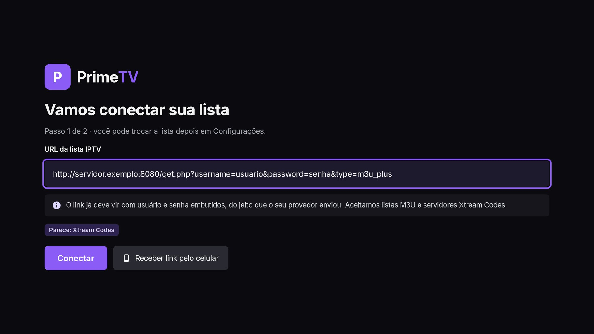 | 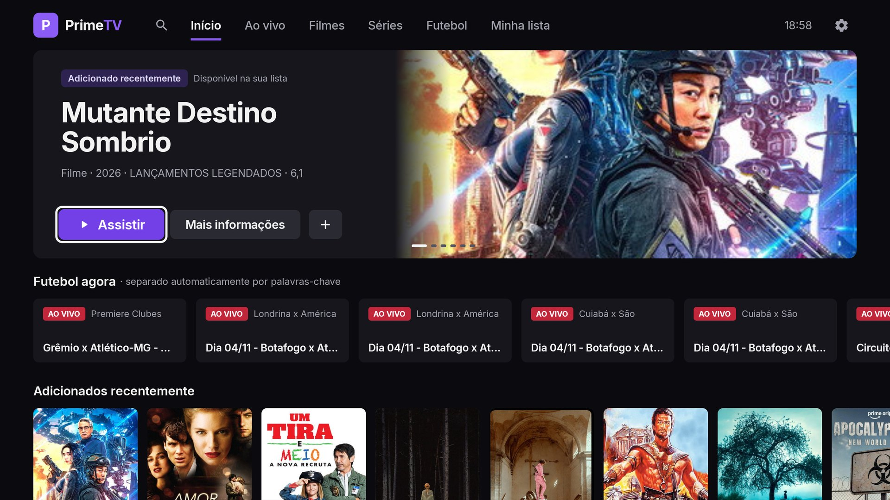 |

| Filmes | Séries |
|---|---|
| 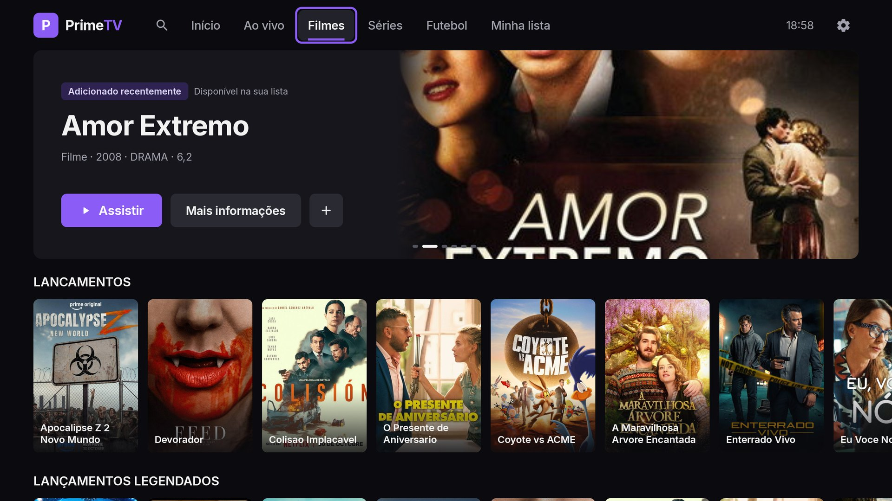 | 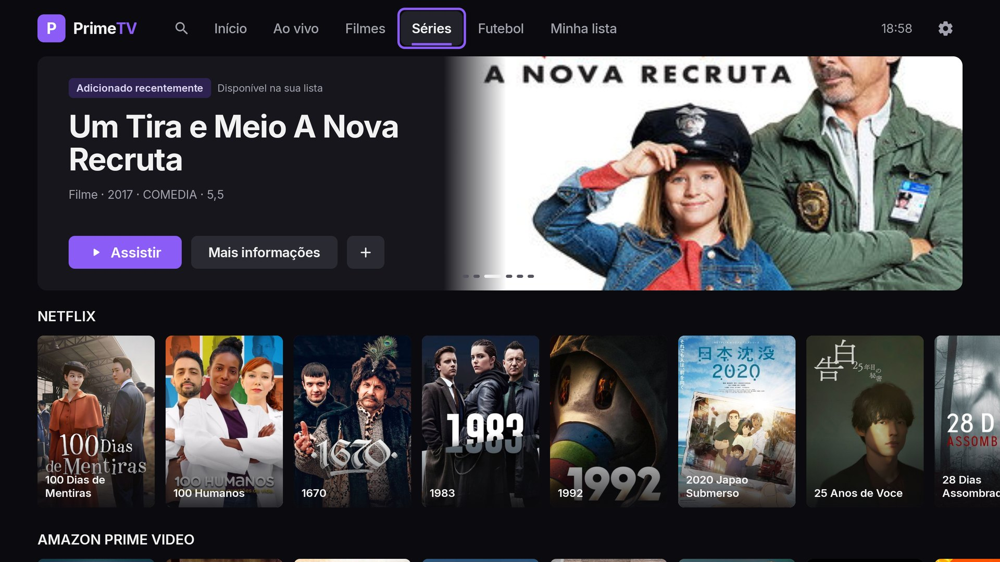 |

| Detalhes de série | Detalhes de filme |
|---|---|
| 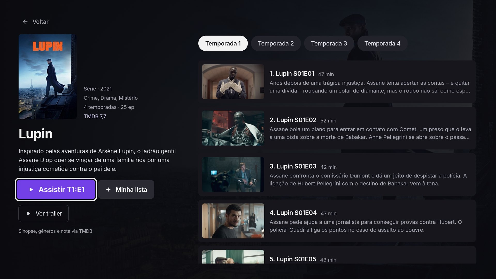 | 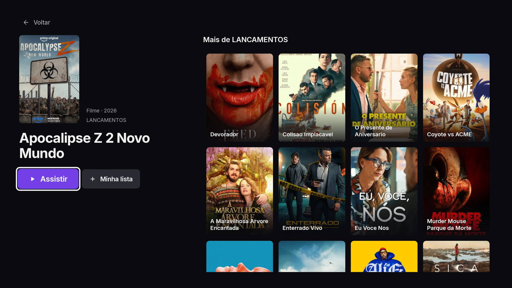 |

| Ao vivo com guia | Futebol |
|---|---|
| 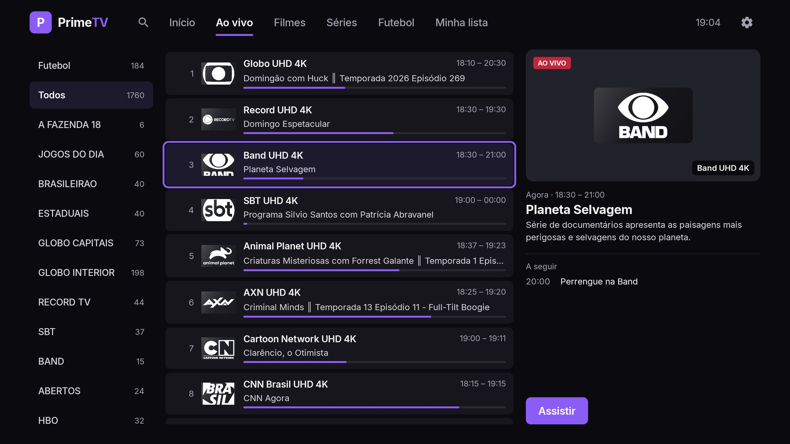 | 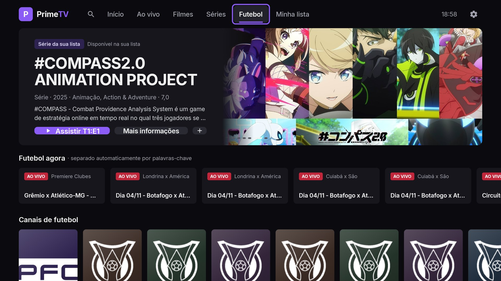 |

| Busca | Categoria completa |
|---|---|
| 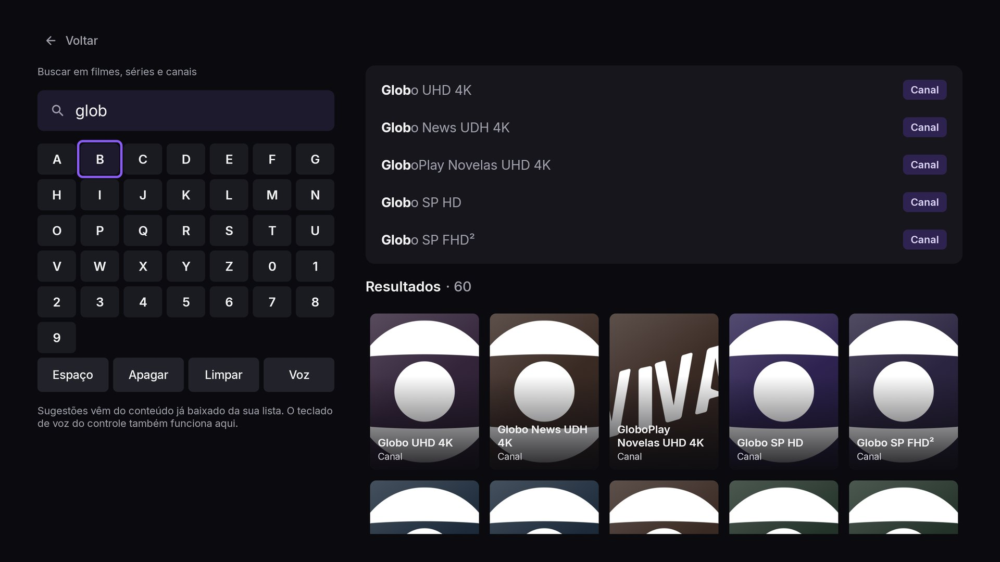 | 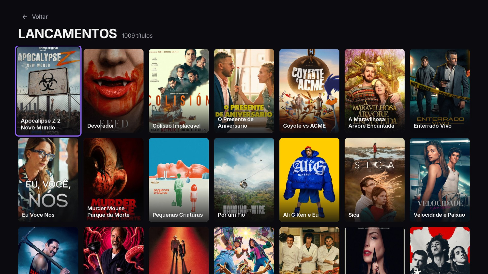 |

| Player ao vivo | Player com episódios |
|---|---|
| 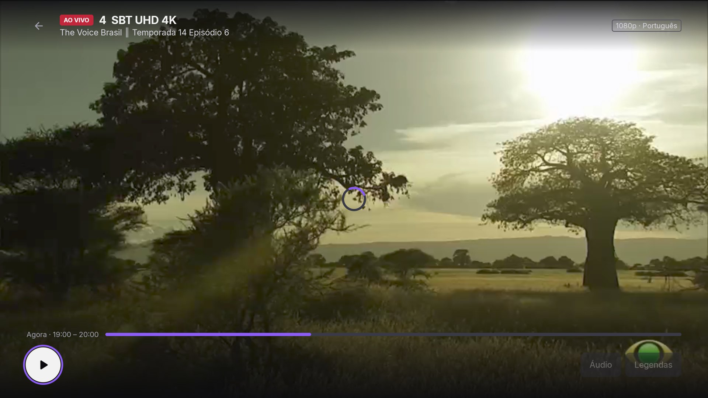 | 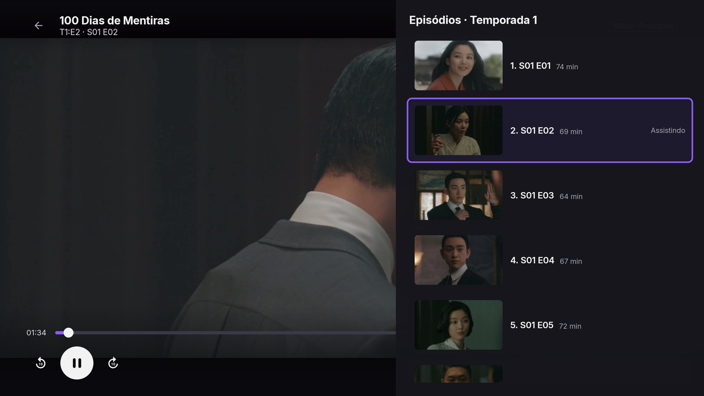 |

| Configurações | Palavras-chave de futebol |
|---|---|
| 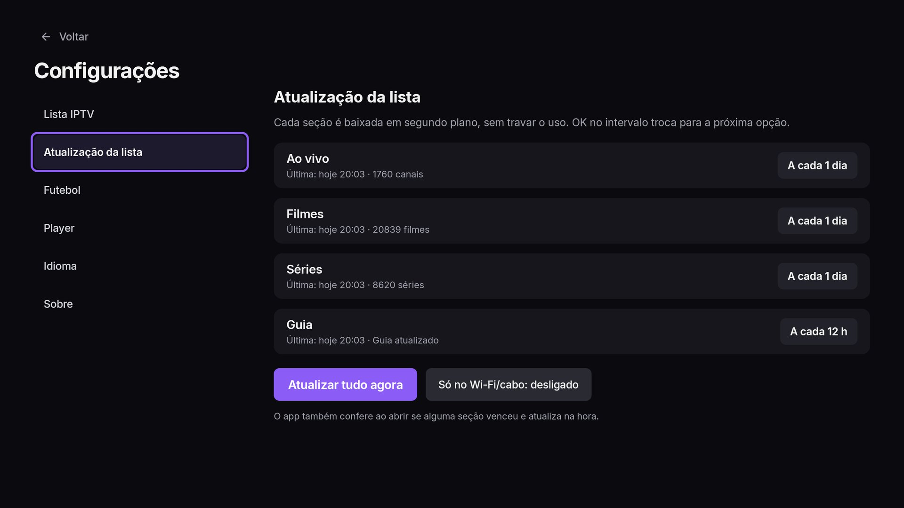 | 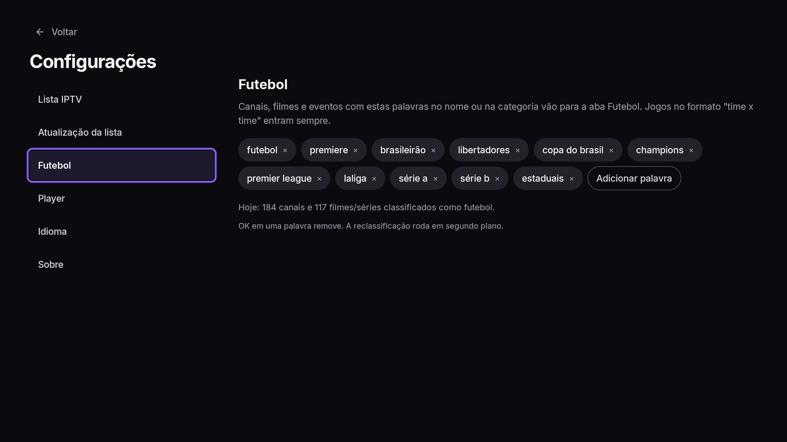 |

| Receber link pelo celular | Sobre (atribuição TMDB) |
|---|---|
| 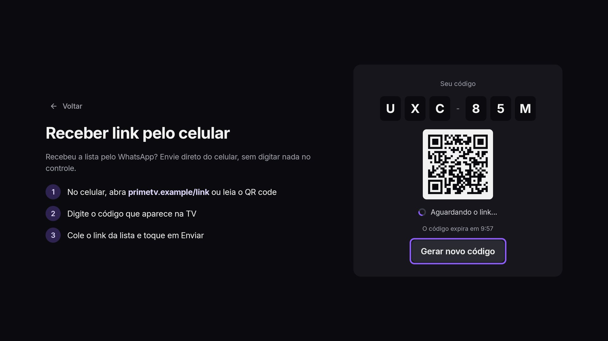 | 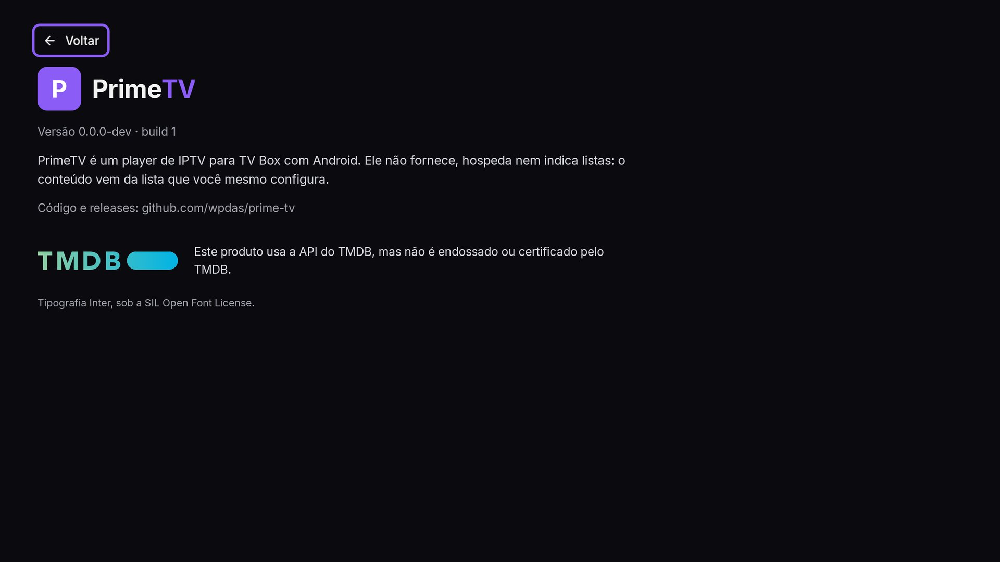 |

| Verificar atualização | |
|---|---|
| 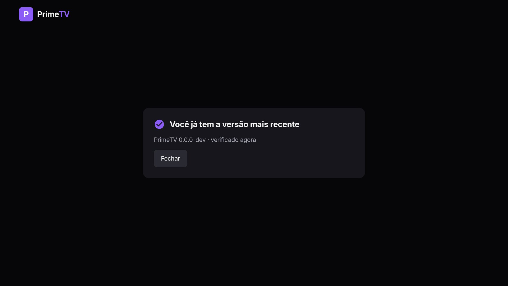 | |

## Requisitos para compilar

- JDK 17
- Android SDK com `platforms;android-37` e `build-tools;36.0.0` (o Android Studio instala)
- `local.properties` com `sdk.dir` e, opcionalmente, `TMDB_API_KEY=...` (sem a chave, o destaque usa itens da própria lista)

```bash
make build          # APK debug em app/build/outputs/apk/debug/
make test           # testes unitários
make install        # instala no aparelho/emulador conectado via adb
make help           # todos os atalhos
```

## Instalar na TV Box

O APK universal (`armeabi-v7a` + `arm64-v8a`) é publicado em cada release do GitHub.

- **Pendrive:** copie o `.apk` para um pendrive, abra o gerenciador de arquivos da box e toque no arquivo. Se pedir, autorize "Instalar apps desconhecidos" para o gerenciador.
- **Downloader / navegador:** baixe o `.apk` pelo link da release e abra o arquivo baixado.
- **adb:** com depuração USB/rede ativa na box:
  ```bash
  adb connect <ip-da-box>:5555
  adb install -r primetv-vX.Y.Z.apk
  ```

Depois da primeira instalação, o próprio app avisa quando há versão nova e faz a atualização.

## Assinatura (release)

O APK release é assinado com um keystore próprio, fora do repositório. **Todas as versões precisam da mesma chave**: se a chave mudar, o Android recusa a atualização por cima da anterior e o usuário tem de desinstalar e instalar de novo. Perder o keystore significa perder a capacidade de atualizar quem já instalou.

### 1. Gerar o keystore (uma única vez)

```bash
keytool -genkeypair -v -keystore primetv.jks -alias primetv \
  -keyalg RSA -keysize 2048 -validity 10000
```

Guarde a senha do keystore e a senha da chave (podem ser iguais).

### 2. Guardar o keystore com segurança

O arquivo `primetv.jks` e as senhas ficam **fora do git** (`*.jks` e `keystore.properties` já estão no `.gitignore`). Hoje a cópia de segurança fica no **Google Drive** do mantenedor, na pasta privada **Prime TV - App › keystore**, junto com um arquivo de texto com alias e senhas. O arquivo original fica na raiz do clone local (`primetv.jks`), ignorado pelo git. Recomendações:

- Não compartilhe a pasta; se precisar dar acesso a outra pessoa, compartilhe só com a conta dela.
- Mantenha uma segunda cópia (gerenciador de senhas ou outro armazenamento) para não depender de um único lugar.
- Se o keystore vazar, não há como revogar: será preciso publicar o app com outra chave e os usuários terão de reinstalar.

### 3. Assinar localmente (opcional)

Crie `keystore.properties` na raiz do projeto:

```properties
storeFile=/caminho/para/primetv.jks
storePassword=...
keyAlias=primetv
keyPassword=...
```

`make release` gera `app/build/outputs/apk/release/app-release.apk` assinado. Sem esse arquivo, o build release é assinado com a chave de debug, só para testar o APK minificado no emulador; não distribua esse APK.

### 4. Secrets no GitHub (para a release automática)

Em **Settings › Secrets and variables › Actions**, crie:

| Secret | Conteúdo |
|---|---|
| `KEYSTORE_BASE64` | o `primetv.jks` em base64: `make keystore-base64 KS=/caminho/primetv.jks` |
| `KEYSTORE_PASSWORD` | senha do keystore |
| `KEY_ALIAS` | `primetv` (ou o alias que usou) |
| `KEY_PASSWORD` | senha da chave |
| `TMDB_API_KEY` | chave da API do TMDB |

## Publicar uma versão

1. Garanta que `main` está verde no CI.
2. Crie a tag: `make tag V=1.0.0` (ou `git tag -a v1.0.0 -m "PrimeTV v1.0.0" && git push origin v1.0.0`).
3. O workflow **Release** compila, assina, gera `primetv-v1.0.0.apk` com o `.sha256` e publica a release com as notas geradas a partir dos PRs/commits. Edite o texto da release se quiser; é ele que aparece no app como changelog.
4. Quem já tem o app recebe o aviso na Início em até um dia, ou pode usar **menu do logo › Verificar atualização**. O app baixa o APK e o Android pede a confirmação da instalação (na primeira vez, pede também a permissão "instalar apps desconhecidos" para o PrimeTV).

`versionName` e `versionCode` vêm da tag (`v1.2.3` → `1.2.3` e `10203`). Commits depois da tag viram `1.2.3-dev.N` nos builds locais.

## Créditos

- Este produto usa a API do TMDB, mas não é endossado ou certificado pelo TMDB.
- Escudos de times vêm do TheSportsDB e são exibidos a partir da internet; não são fornecidos pelo PrimeTV.
- Tipografia Inter, sob a SIL Open Font License.
